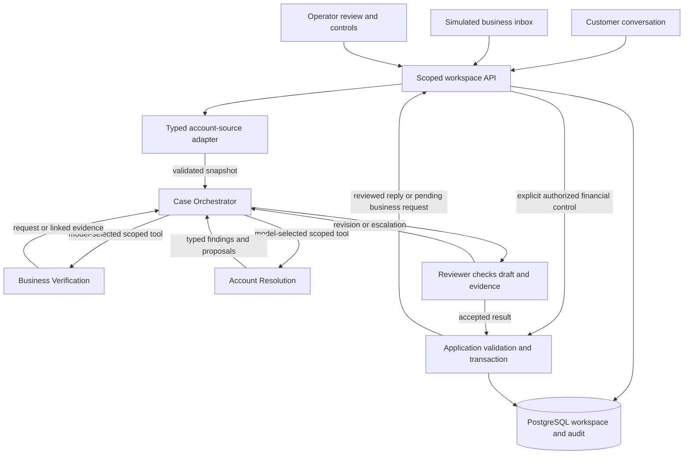
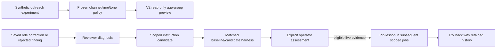

# V2 architecture

Recovery Lab is a private, synthetic billing/recovery demo with two businesses and twelve cases. It uses the **OpenAI Agents SDK for TypeScript**, Next.js/Node.js and PostgreSQL. The SDK supplies agent/tool execution; application code supplies durable state, permissions, review gates and transactions. It is not a new orchestration framework or a production collections service.

## Conversation and cross-party work

| Role | Why it is separate | Boundary |
| --- | --- | --- |
| Case Orchestrator | Maintains one customer-facing voice and chooses relevant investigation, clarification and escalation. Simple reads stay here. | Cannot turn a customer claim into payment authority or write arbitrary SQL. |
| Business Verification | Owns a separate business-facing dialogue and may wait for another party across runs. It interprets an authorized, request-linked reply. | Cannot impersonate the customer, publish customer replies or change balances. |
| Account Resolution | Reconciles evidence/intent and proposes commitments, preferences, contact events and calculated payment options. | Proposes typed changes; code performs arithmetic/validation and approved writes. |
| Reviewer | Challenges the proposer against evidence, policy and communication requirements. Also diagnoses saved feedback outside the customer turn. | Cannot supply missing evidence, execute finance, bypass guards or activate its own instruction change. |

The model selects specialist tools when useful; code does not route customer intent through a keyword tree. Payment verification accepts a bounded `PaymentClaim` interpretation in that existing tool call: account/source scope, original claim/latest customer context IDs, invoice/amount/date values or unknowns, message citations and uncertainty. The specialist sees agent questions as well as customer answers; Account Resolution and Reviewer receive the same interpretation. Code checks provenance/freshness and scope, while Reviewer checks whether the cited words support the meaning. Neither interpretation nor review alone supplies payment authority. The interpretation is retained in workspace review/audit and correction/learning evidence. Its amount.value is explicitly integer US cents; agreement to investigate is distinct from reporting money received. Current baseline `v2-claim-2` excludes older learned instructions from application; archived comparisons remain historical. Agent definitions exist for a run, but not every role must make a model call. Scope, tool availability, call/deadline limits and financial authority are enforced in code. Reviewer remains a required publication check; rejection can trigger one bounded revision, then a saved operator hold.

An external-party handoff is persisted work, not a continuously running agent. A reviewed business question is saved in the simulated inbox, the active run ends, and a request-linked business reply starts subsequent work. No provider polling, real notification, email, call or scheduler is involved. The UI light indicates which simulated participant should act; Runtime describes model calls, not hidden reasoning.

## State and effects

Messages, requests, reviews, operator corrections, commitments/events, agreements, attempts, receipts, decisions and instruction versions are scoped to a private workspace. PostgreSQL row locks, revisions and stable command IDs fence concurrent/stale/duplicate effects. Incoming messages save independently; an accepted reply/update publishes only after review and validation. Fixed expiry, STOP and operator control remain authoritative.

Financial controls commit the authorized simulated effect before any agent explanation. Explicit resume/retry explains saved evidence and cannot replay the operation. Failed/pending/unknown attempts are not receipts. Credits reduce debt without collecting money; a reversal retains/annotates its original local receipt and restores the amount. Original attempts and compensating decisions remain inspectable. No payment provider or refund executes.

The runtime uses saved synthetic source facts. A separate PostgreSQL mapping is exercised against the isolated test database through the same adapter contract. A new database needs an explicit typed schema/capability mapping and scoped connection; changing a URL cannot interpret arbitrary tables. Unsupported external writes and changed-snapshot reconciliation fail closed. Source data, workspace state and business policy are distinct boundaries.

## Two different learning systems

V1's epsilon-greedy picker tries eight channel/window/tone combinations, learns from synthetic payment rewards, freezes its choices and tests them on new paired synthetic cases. V2 exposes a compact snapshot of preserved run `picker-20261016-011624-901`, with versions, source hash, fixed seeds 11/22/33 and 500 training/200 paired test cases per age group. Tests reproduce its choices with the unchanged V1 algorithm. The UI imports neither trial rows nor the training runner, and does not read/write the V1 database.

V2 facts have no overdue-age field. The age selector is explicitly hypothetical and resets when the selected case changes. It does not infer age from a scenario, update source facts, select a chat prompt, approve contact or schedule an event. The frozen benchmark is not business-specific training. STOP, operator-hold, missing-destination and preference-conflict notices remain visible when relevant. A source hash identifies the original artifact; it is not a provider signature. `/picker` remains the separate V1 experiment page, which may display a different latest imported run.

V2's instruction loop starts from saved evidence. Reviewer proposes one supported reusable change; a separate software harness compares baseline/candidate outputs on target, regression and safety cases. Eligibility is recomputed, then an operator explicitly activates or rejects it. Scope includes workspace, business, role and optionally scenario family. New jobs pin versions; in-flight inputs do not change. Rollback restores an eligible prior version or base and retains history. Data repairs, unsafe proposals, failed/tied/incomplete or scripted comparisons cannot activate. Model weights and application code do not train/rewrite themselves.

`npm run eval:v2:replay` rechecks selected saved live outputs without a key/database. It is not exact SDK/provider-request replay, new live-model evaluation or a final holdout. V1's `npm run eval:replay` remains separate. Neither synthetic reward scores nor small instruction comparisons establish real collection lift or superiority over a single-agent baseline.

## Code entry points

| Area | Main files |
| --- | --- |
| UI and role simulation | `src/components/v2/InvestigationWorkspace.tsx`, `OutreachStrategy.tsx` |
| Scoped commands and persistence | `src/lib/v2/http.ts`, `store.ts`, `contracts.ts` |
| Runtime roles and model bounds | `src/lib/v2/agents.ts`, `model.ts` |
| Sources and financial rules | `src/lib/v2/source.ts`, `payments.ts`, `financial.ts` |
| Candidate/evaluation/version loop | `src/lib/v2/learning.ts`, `learning-model.ts`, `learning-checks.ts` |
| Frozen outreach preview | `src/lib/v2/outreach.ts`, `fixtures/v2/outreach-policy-v1.json` |
| Offline evidence reports | `src/lib/v2/eval-replay.ts`, `fixtures/v2/learning-20261024-1/` |

Real connectors/messages/payments, timed outreach, shared lesson promotion, fine-tuning, a connector marketplace and public deployment are outside this build. Remaining broad journey acceptance and optional hosting assessment are not completed by this architecture document.
