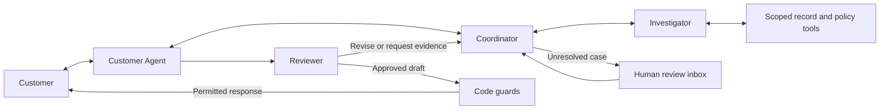

# Recovery Lab Version 2: functional and non-functional specification

Status: V2 build contract. Contracts, scoped tools, frozen evaluation fixtures, transactional cases/history, visitor APIs and operator OAuth/membership reads are implemented. The leased worker checkpoints four mock roles and bounded review, now producing typed pending billing proposals from observed tools with policy/arithmetic checks before completion. Durable request/usage/output checkpoints are implemented with an injected fake transport; see [model steps](MODEL-STEPS.md). The single-attempt OpenAI adapter is tested with fake HTTP responses. An internal [four-role model-test workflow](MODEL-WORKFLOW.md) now exercises the SDK/checkpoints with scripted HTTP and response-selected scoped tools. The internal test path now permits one feedback-driven revision and atomically saves a guarded proposal/escalation with operator handoff. Customer chat/status UI is implemented and browser-tested with fake HTTP; actual V2 setup/browser acceptance remains open. The default worker remains mock; activity/evidence/operator UI, live activation, active lesson pins and approval/actions remain planned. Real GitHub browser acceptance is pending credentials; model performance and NFR targets are unmeasured. See [implementation evidence](DECISIONS.md), [mock workflow](WORKFLOW.md) and [run limits](RUNS.md).
Date: October 20, 2026. Scope revised by Akshay: resume demonstration only, with no commercial launch or sales-readiness requirement. The scope rules below supersede broader wording in historical task records; no deferred requirement is claimed as implemented.
Implementation sequence: [PLAN.md](PLAN.md).

## 1. Product objective and scope

Build a portfolio-quality, four-agent case-resolution application. A customer talks to one Customer Agent while a Coordinator, Investigator, and Reviewer collaborate behind the conversation. The system investigates synthetic business records, proposes evidence-backed resolutions, handles human decisions, and improves through versioned lessons tested against independent cases.

Collections and billing disputes are the first business workflow. Extensibility means supporting another business through policies, records, tools, and evaluation fixtures while retaining the four roles. A general-purpose agent builder, marketplace, and commercial billing system are outside this release.

V2 builds alongside V1. The root PRD, SPEC, and historical plan remain the V1 contract. This specification governs the new V2 surfaces; it does not silently change existing V1 behavior, results, or recordings. Project version 2 is distinct from the existing live-only `rules: "v2"` prompt/guard setting.

### Included in the resume demonstration

- Four model-backed agent roles with typed internal messages and bounded delegation.
- Persistent customer chat, cases, tasks, evidence, proposals, and human decisions.
- Synthetic invoices, payments, allocations, cancellations, adjustments, and policies.
- Server-executed tools, durable background work, retry handling, and execution limits.
- A case workspace showing chat, agent collaboration, evidence, and current state.
- Reusable authorized case review, clarification and a versioned learning loop handling multiple feedback events/candidates with manual decision and rollback.
- A small declared before/after validation report and immutable replay of the selected four-role recording.
- Two fictional business configurations proving policy and data isolation.

### Deferred

Real customer data, real SMS/email delivery, real payments, accounting integrations, autonomous balance changes, fine-tuning, self-modifying source code, a fifth runtime agent, additional model providers, vector databases, and subscriptions/payments for the platform. Also deferred: public hosting/deployment, always-on hosted workers, scale/load targets, production migration rehearsals, elaborate operator/admin features, automatic lesson promotion, a dedicated learning dashboard, general connector interfaces and full three-way architecture/final-holdout benchmarking. Lightweight case selection and request-information remain in scope. Existing implemented foundations stay in place.

### Requirement scope for this demonstration

| Area | Portfolio acceptance boundary |
| --- | --- |
| V2-FR-22 human review | Reusable authenticated case review with approve/reject/request-information, reason and history; lightweight case selection. Elaborate inbox/admin features deferred. |
| V2-FR-25-30 learning | Repeated scoped feedback/candidate/evaluation cycles across different role/situation contexts, a declared source-independent validation/regression set, eligibility-controlled manual activation/rejection, inspectable history and rollback. No cap of one lesson. CLI/compact reports are sufficient; automatic promotion remains deferred. |
| V2-FR-31 comparisons | Deferred. No claim that four agents outperform a single agent. |
| V2-FR-32-34 evaluation/replay | Reuse frozen fixtures; preserve split isolation and locked holdout. Report actual results/usage for the small selected evaluation and replay the selected recording strictly. Full final-holdout benchmarking is deferred. |
| V2-NFR-03 performance | Numerical scale target is deferred. Report observed demo duration without an SLA claim. |
| V2-NFR-13 migration rehearsal | Keep integer arithmetic, references, non-destructive changes and isolated DB tests. Production-copy rehearsal is deferred. |
| V2-NFR-15 hosting | Run the existing Node worker locally, independently of web requests. Hosted operation and public deployment are deferred. |
| All other scope/security controls | Preserve validation, authenticated isolation, STOP, limits, stale/duplicate-action protection, traceability and V1 separation for the implemented path. |

The completion target is a compact system with meaningful behavioral depth and truthful resume evidence. The reference case is a walkthrough anchor, not the only supported input. Exercise verified/partial payments, ambiguous/missing evidence, policy differences and tool failures through resolution, clarification, reinvestigation and escalation. Reuse existing fixture families without exposing hidden evaluation data. Negative lesson results remain useful evidence; repeated learning must follow a declared evaluation/spend boundary rather than unlimited tuning.

## 2. Actors and four-agent architecture

| Actor/role | Responsibility | Allowed output and authority |
| --- | --- | --- |
| Customer Agent | Own the customer conversation, clarify requests, propose a resolution, and draft the response | Structured draft, proposal, or request for help; cannot directly change balances or publish unchecked text |
| Coordinator | Decompose a case, assign bounded tasks, combine task status, and choose continuation or escalation | Validated task assignments and routing decisions; cannot grant permissions or bypass a review |
| Investigator | Read business records and policies through tools; reconcile evidence and identify gaps | Findings with record references and explicit uncertainty; cannot invent evidence or execute financial changes |
| Reviewer | Review substantive drafts/proposals, request corrections, and propose candidate lessons | Approve, request revision, or escalate with reason codes and evidence references; cannot activate a lesson by itself |
| Human operator | Resolve ambiguous cases, approve permitted simulated actions, and manage learning releases | Authenticated, audited decisions within the selected business |
| Visitor/customer | Chat within an isolated synthetic case and inspect its activity | No access to other visitors' cases, global configuration, or lesson activation |

There are exactly four runtime agent roles. They may share one underlying model. Different prompts, context, tools, and permissions distinguish them. Agent communication is mediated by application code and persisted; agents do not call each other through unrestricted recursive loops. Learning proposals use the existing Reviewer role in an offline mode, not a fifth agent.

The diagram shows logical roles. A durable runtime executes each step, validates every transition, and records all messages and effects. Independent invoice/payment reads may run concurrently under one investigation. Four roles do not require four simultaneous model calls on every customer turn.

### Reference workflow

1. A customer disputes an $84 invoice, reports a $50 payment, and identifies a cancelled $20 service.
2. The Customer Agent acknowledges the investigation without repeating a payment demand. The Coordinator creates an investigation task.
3. The Investigator retrieves the invoice, payment/allocation records, cancellation history, and effective business policy. Independent reads may run concurrently.
4. Findings show a verified $50 unapplied payment and an eligible $20 credit. Server-side arithmetic computes a proposed remaining balance of $14.
5. The Customer Agent proposes the resolution and drafts a response. The Reviewer checks evidence, arithmetic inputs, policy eligibility, and whether the draft accurately says the change is pending approval.
6. Missing or conflicting evidence returns to the Coordinator for a targeted follow-up. Uncertainty or exhausted limits moves the case to human review.
7. An authorized operator approves the proposal. A transaction applies the simulated allocation/credit once, and the Customer Agent drafts the confirmed result for review and code checks.
8. Human corrections and observed failures can produce candidate lessons. No customer promise is treated as payment evidence.

## 3. Functional requirements

Requirements apply within the portfolio acceptance boundaries above; deferred extensions are not mandatory for this demonstration. Acceptance criteria describe evidence to collect, not results already achieved.

### Customer experience and case lifecycle

| ID | Requirement | Acceptance criteria |
| --- | --- | --- |
| V2-FR-01 | Keep the Customer Agent as the sole model-generated customer-facing voice. | Customer transcript contains no internal task messages; every published model draft links to a review and final guard decision. |
| V2-FR-02 | Store cases, messages, and progress on the server; accept message text and case ID rather than trusting client-supplied history or balance. | Refresh/restart preserves history; edited client state cannot alter stored facts; repeated submission with the same idempotency key creates one message/task. |
| V2-FR-03 | Implement case states `open`, `investigating`, `awaiting_customer`, `awaiting_human`, `resolved`, and `closed`. | A transition table rejects illegal transitions; reasons are recorded; new customer evidence may reopen a resolved case into a new run; closed cases require an explicit authorized reopen, and contact suppression persists. |
| V2-FR-04 | Distinguish case status, task execution status, and financial outcome. | A failed task does not imply a closed case; a promise, proposed credit, approved adjustment, and confirmed simulated payment are shown and counted separately. |
| V2-FR-05 | Preserve stop-contact behavior and pause payment requests during a dispute. | STOP cancels/suppresses queued customer contact; a dispute opens investigation without further demands; no internal agent decision can override suppression. |
| V2-FR-06 | Show chat, progress, evidence, proposals, and an agent activity timeline in a case workspace. | A user can follow the reference case and inspect sender, recipient, task, findings, tool status, and review reasons; progress and errors remain visible after refresh. |

### Collaboration and orchestration

| ID | Requirement | Acceptance criteria |
| --- | --- | --- |
| V2-FR-07 | Implement the four roles in section 2 as independently configured model-backed steps. | Each role has a prompt version, output schema, and allowlisted tools/recipients; a mock integration run exercises all four and a live recording later demonstrates them. |
| V2-FR-08 | Use structured inter-agent envelopes and persisted task/result messages. | Invalid sender, recipient, case/business scope, schema version, or parent-task linkage is rejected before execution. |
| V2-FR-09 | Let the Coordinator select necessary subtasks from an allowlist based on current evidence. | Complete evidence can take a short path; missing cancellation/payment evidence triggers a targeted investigation; no unneeded all-agent broadcast is required. |
| V2-FR-10 | Support concurrent independent tool reads and ordered dependent work. | Controlled delayed invoice/payment fixtures overlap; proposal generation waits for required results; partial failures remain explicit. |
| V2-FR-11 | Support reviewer-requested revisions and reinvestigation with bounded loops. | An unsupported claim is rejected, missing evidence is requested, and a revised draft is reviewed; exceeding the configured revision/step budget produces an `awaiting_human` case. |
| V2-FR-12 | Execute work durably outside request lifetime. | A queued case finishes or pauses through an explicitly running worker; stopping the worker between steps and restarting it resumes from persisted work without losing accepted messages or approved effects. |
| V2-FR-13 | Enforce per-run limits and cancellation across all roles, tools, and retries. | Budget exhaustion prevents further dispatch; cancellation invalidates stale outputs; failures leave a reason and recoverable case state. |

### Tools, evidence, and business records

| ID | Requirement | Acceptance criteria |
| --- | --- | --- |
| V2-FR-14 | Provide typed tools for invoice details, payment search/allocations, account history, cancellation/adjustment history, and effective policy lookup. | Each tool has validated arguments/results, permission checks, timeout behavior, and explicit found/not-found/unavailable results; agents receive no raw SQL capability. |
| V2-FR-15 | Give findings and proposals verifiable evidence references. | References resolve to records/results accessible to the current business and case; nonexistent, foreign, or stale references cannot authorize a change. Unsupported narrative claims can still fail review/evaluation. |
| V2-FR-16 | Generate deterministic, internally consistent synthetic records with separate hidden expectations. | Same seed/version gives identical records; allocations cannot exceed payment/invoice amounts; test oracles and scenario answers never enter prompts, tool results, or runtime-readable tables. |
| V2-FR-17 | Compute money and policy eligibility in code. | Integer-cent arithmetic produces $14 in the reference case; approved and pending amounts are distinguished; rounding, duplicate allocation, over-credit, and unsupported plans are rejected. |
| V2-FR-18 | Represent resolutions as proposals before applying simulated business changes. | Proposal contains typed action, inputs, evidence, policy version, expected record versions, and approval requirement; no model directly changes a ledger. |
| V2-FR-19 | Apply an authorized simulated action transactionally and idempotently. | Duplicate approvals/retries produce one effect; stale evidence or record versions require revalidation; audit record and financial effect commit together. |
| V2-FR-20 | Include exact-match, ambiguous, contradictory, missing-record, partial-payment, cancellation, duplicate-request, and tool-failure cases. | Each category has at least two independently authored variants across evaluation splits; ambiguous cases explicitly expect clarification or human review. |

### Review and human decisions

| ID | Requirement | Acceptance criteria |
| --- | --- | --- |
| V2-FR-21 | Review substantive model drafts/proposals, then enforce deterministic guards immediately before publication/action. | A Reviewer-approved draft that violates a hard rule is blocked; customer-facing content describes proposed changes as pending until committed; fixed system acknowledgements/STOP handling do not require model review. |
| V2-FR-22 | Provide authorized case review with evidence, proposed action, and decision history. | An operator can approve, reject or request information with a reason; the case resumes from the recorded decision; competing decisions cannot both commit. Lightweight case selection included; elaborate inbox/admin features deferred. |
| V2-FR-23 | Separate visitor, operator, and business permissions. | Visitors access only their synthetic case workspace; authenticated operators manage only authorized businesses; public visitors cannot approve financial actions or activate lessons. |
| V2-FR-24 | Log the full execution path without exposing private model reasoning. | Timeline shows bounded decision summaries, record references, tool status, review outcomes, prompt/model versions, usage, and timestamps; secrets and hidden evaluation answers are absent. |

### Self-improvement

| ID | Requirement | Acceptance criteria |
| --- | --- | --- |
| V2-FR-25 | Collect feedback tied to the responsible role, case step, and observed error. | Human correction, reviewer rejection, and independently scored failure can be traced to their source; positive reviewer feedback is not treated as ground truth. |
| V2-FR-26 | Use the Reviewer in an offline mode to propose scoped lessons for any of the four roles. | Candidate includes source examples, proposed instruction, target role/business/situation, expected benefit, and conflicts; customer instructions cannot directly become active lessons. |
| V2-FR-27 | Version lessons through `candidate`, `evaluating`, `eligible`, `active`, `rejected`, and `retired`. | Activation records actor, evaluation run, previous version, and reason; conflicting/duplicate lessons are rejected or deliberately superseded; active sets have bounded size. |
| V2-FR-28 | Evaluate candidates against independent regression and validation cases before activation. | Existing active set and candidate use identical fixtures/tools/model settings; no hard-rule regression or mandatory-case failure is allowed; candidate-specific failures must improve on independent validation cases, not only the source example. |
| V2-FR-29 | Support owner-approved promotion; automatic promotion is deferred. | Manual activation requires eligibility and records its actor/reason; visitors cannot promote; lessons cannot change code, permissions or hard rules. |
| V2-FR-30 | Support rollback and reproducible instruction snapshots. | Each run pins prompt/lesson/policy versions; rollback changes future runs and explicitly restarted work; in-flight cases do not silently change instructions; failed candidates remain inspectable. |

Self-improvement means measured updates to instructions and scoped lessons. It does not mean changing model weights or guaranteeing monotonic improvement. A candidate that fails its gates remains inactive. Coordinator routing lessons and Investigator tool-selection lessons are supported by the same lifecycle as Customer Agent and Reviewer lessons.

### Evaluation, replay, and extensibility

| ID | Requirement | Acceptance criteria |
| --- | --- | --- |
| V2-FR-31 | Deferred: compare V1 guarded behavior, a tool-enabled single agent, and the four-agent workflow. | No architecture-superiority claim until equivalent-access, equivalent-budget comparison evidence exists. |
| V2-FR-32 | Separate development/source examples, validation, and a locked final holdout. | Minimum 12 development, 12 validation, and 12 final-holdout cases, split by underlying case family rather than cosmetic paraphrase; record hashes before final evaluation; final holdout never selects lessons or prompts. |
| V2-FR-33 | Measure resolution correctness, unsupported claims, evidence grounding, escalation quality, completion, latency, and usage. | Denominators and not-applicable cases are explicit; timeouts, missing outputs, and exhausted budgets count; report before/after learning results and per-role usage; publish negative results. |
| V2-FR-34 | Record/replay all model outputs, tool requests/results, handoffs, decisions, and versions needed for reproducible execution. | V2 offline replay reconstructs each selected run and verifies expected requests/transitions; missing/mismatched entries fail closed; no live fallback or replacement of V1 recordings. |
| V2-FR-35 | Separate reusable runtime from business-specific configuration and tools. | A typed configuration selects policy, tools, prompts, vocabulary, and allowed proposal types; adding a second fictional billing business requires no edits to the orchestration state machine. |
| V2-FR-36 | Isolate records, policies, lessons, caches, and executions by business/workspace. | Two businesses with colliding external invoice IDs cannot leak data or influence each other's lessons; authorization applies on reads, writes, tool dispatch, replay/export, and worker execution. |
| V2-FR-37 | Preserve V1 routes, metrics, and immutable replay evidence during incremental delivery. | Existing tests/replay pass; V2 data and results have explicit provenance; V1 figures never include V2 adjustments or learning runs. |
| V2-FR-38 | Provide a reproducible portfolio demonstration and operator runbook. | A fresh setup can seed records, run mock cases, inspect the four-agent exchange, resolve a review, test a lesson, and replay evidence using documented functional commands. |

## 4. Non-functional requirements

These apply within the portfolio boundary above. Record actual environment/results; deferred scale targets are not achieved performance. Correctness/security gates remain required for the demonstrated behavior. External-model usage and failures remain explicit.

| ID | Requirement and initial target | Verification |
| --- | --- | --- |
| V2-NFR-01 | Reliability: accepted work survives API/worker restarts. No duplicate committed business effect under at-least-once execution. | Crash tests before/after task completion and financial transaction; repeat delivery/approval; verify one committed effect and ordered audit events. External model calls may repeat and must remain budgeted. |
| V2-NFR-02 | Concurrency: case revisions and worker leases prevent stale writes. | Two workers race one task and two updates target one case version; only the valid owner/revision commits; expired leases recover. |
| V2-NFR-03 | Deferred scale target: p95 reads/acknowledgements below 1 second at 10 sessions/1,000 cases. | No load benchmark needed for the resume demo; record observed demo timings without claiming this target passed. |
| V2-NFR-04 | Bounded execution: initial defaults are 12 model requests including retries, 16 tool invocations, 2 review revision cycles, and 180 seconds active wall time per run. Model request timeout 30 seconds; tool timeout 5 seconds. Human/customer waiting is excluded. | Boundary tests use injected time/providers. Coordinator cannot increase limits. Hitting a limit pauses for human review and blocks new dispatch. Defaults may change only through versioned configuration and recorded measurements. |
| V2-NFR-05 | Resource control: maximum 24,000 input-plus-output tokens per run and 600 output tokens per request initially; shared daily allowance and per-visitor throttles. | Atomically reserve conservative capacity before dispatch, settle observed usage, retain reservations for unknown outcomes, and prevent retries from bypassing caps. Report spend estimates only with a dated explicit pricing configuration. |
| V2-NFR-06 | Security: all IDs, inputs, model outputs, tool calls, and state transitions are validated; use parameterized SQL and role-based server permissions. | Negative tests for malformed output, injection attempts, unauthorized actions, forged IDs, and cross-business references; secrets absent from logs/client bundles/fixtures. |
| V2-NFR-07 | Instruction integrity: record/customer/tool text is untrusted data. Evidence cannot redefine system rules, tools, or recipients. | Adversarial fixtures embed override instructions in customer messages, invoice notes, and tool results; hard rules and authorization remain enforced. |
| V2-NFR-08 | Traceability: 100% of committed messages/actions link to case/run/task, relevant versions, guard/review outcome, and actor. | Trace completeness check; incomplete traces fail the release fixture; provider errors are sanitized. |
| V2-NFR-09 | Reproducibility: mock and replay CI make no network calls or DB connections; no secrets required. | Network-deny tests and independent V1/V2 replay jobs; same pinned fixtures produce the same non-volatile results. DB tests use only a dedicated throwaway database. |
| V2-NFR-10 | Maintainability: strict TypeScript and shared Zod contracts; four explicit role implementations and one runtime transition model. | Typecheck, lint, behavioral tests, and review; no unrestricted agent framework or generic plugin loader introduced without a demonstrated need. |
| V2-NFR-11 | Extensibility: second business configuration runs all mandatory workflows without changes to coordinator/runtime code. | Contract tests load both configurations and verify policy differences, tools, scoped lessons, and isolation. |
| V2-NFR-12 | Accessibility: core chat, activity, evidence, and review flows are keyboard accessible with labeled controls, visible focus, text status, and announced asynchronous updates. | Automated accessibility checks plus the user's keyboard/browser acceptance pass; color is not the only status indicator. |
| V2-NFR-13 | Data integrity: currency-qualified integer cents, UTC instants plus business/customer timezone, referential constraints, and non-destructive migrations. | Ledger invariants, timezone boundaries and transactional failure checks in isolated schemas. Production-copy migration rehearsal deferred. |
| V2-NFR-14 | Learning quality: promotion requires zero new mandatory hard-check failures, no mandatory scenario regression, improvement on independent targeted validation cases, and continued compliance with resource caps. | Saved paired evaluation report and eligibility decision; no claimed improvement solely from the lesson's originating case or a Reviewer score. Report uncertainty and sample size. |
| V2-NFR-15 | Local execution: request handlers enqueue durable work; a separate local Node worker polls PostgreSQL jobs. | Document local web/DB/worker commands and restart; accepted work survives request completion. Hosted always-on operation/deployment deferred. |
| V2-NFR-16 | Honest presentation: distinguish synthetic/mock/live/replay, pending/committed changes, and application lessons/model training. | Browser/document review; provenance is visible in case and evaluation views; no real-world effectiveness or legal-compliance claims. |

## 5. Data and message contracts

### Logical data model

Names below are proposed V2 entities, not instructions to rename existing V1 tables. Prefer additive `v2_` tables/schema boundaries and reference shared utilities only when semantics match. Every business-owned entity carries `business_id`; private demo work also carries `workspace_id`. Foreign keys/queries must preserve this scope.

| Entity group | Required records |
| --- | --- |
| Business/access | Business config and policy versions; workspace/session and operator membership. Production uses secure opaque visitor sessions and authenticated operator sessions, with a maintained authentication solution selected during Task 1. |
| Synthetic records | Customers/accounts; invoices/line items; payments; payment allocations; cancellations; credit adjustments. Effective dates and record versions distinguish history from current facts. |
| Cases/chat | Cases with revision and contact suppression; customer-visible messages with idempotency keys and publish status. |
| Execution | Runs with pinned versions and budgets; tasks/jobs with leases and retries; internal messages/events; tool calls/results with evidence references and snapshot/version hashes. |
| Resolution | Typed proposals; review decisions; human approvals; append-only simulated action/ledger entries with unique operation keys. |
| Learning/evaluation | Feedback; lesson candidates/versions and activation history; evaluation manifests, results, and promotion decisions. Hidden fixture expectations live outside runtime-accessible storage. |

Do not persist private chain-of-thought. Store structured outputs and short operational explanations. Limit/paginate messages and tool results; agents receive relevant scoped records rather than every case's history.

### Internal message envelope

Required fields: `schemaVersion`, `messageId`, `businessId`, `workspaceId`, `caseId`, `runId`, `taskId`, `parentMessageId`, `sender`, `recipient`, `kind`, `payload`, `evidenceRefs`, `createdAt`, and `idempotencyKey`.

Allowed role senders/recipients are the four agents; system/human events use separate actor types. Message kinds are `task_request`, `finding`, `clarification_request`, `proposal`, `review_result`, and `escalation`. Each kind has its own validated payload and allowed routing transitions. Runtime IDs are provenance, not instructions or hidden answers. Findings include known facts, missing information, and uncertainty; reviews include reason codes and required changes.

### Durable execution rules

- A web transaction accepts a customer message and enqueues work together. The request returns a case/run identifier for polling.
- Workers atomically claim jobs with expiring leases. Only a valid lease and expected case revision can commit a step and enqueue its successor.
- Stable operation keys deduplicate effects. External model execution is at least once, not exactly once; timed-out/unknown attempts remain in usage accounting.
- Tool failures distinguish transient unavailability from valid empty results. One transient retry is allowed only within the overall limits; invalid structured output gets at most one corrective attempt. All attempts share the same counters.
- A new customer message invalidates stale pending publication and supersedes/replans affected work. Contact suppression is checked again at publication, not only when work is queued.
- Case/policy/record revisions are revalidated before approvals and commits. Version changes require a new proposal or explicit restart.

## 6. Surfaces and implementation boundaries

V2 adds reusable case workspace/activity/evidence/review, lightweight case selection and clarification. Lesson history/evaluation evidence may be compact views or CLI/report artifacts. Elaborate administration, learning dashboard and architecture-comparison UI are deferred. Reuse existing components and preserve V1 evidence.

Continue with the installed TypeScript, Next.js, PostgreSQL/pg, Zod, model SDK, and Vitest stack. Use SQL-backed jobs and an explicit Node worker first. Read the installed Next.js guides before writing framework code. Do not select a new agent framework solely to obtain agent naming or message passing.

V1's read-only page dependency boundary and narrow `/api/live` write exception remain valid for V1. V2 requires explicit new authenticated case APIs, scoped database credentials, worker/tool boundaries, and import-graph tests. Update the relevant project guidance and boundary tests as part of implementation; never broaden the public read-only database role or reuse the lessons-only writer for case/ledger writes.

Live credentials/spend controls are needed only for the bounded real-model recording; a local worker is sufficient. Mock/replay and synthetic records proceed without live credentials. Public hosting/deployment is outside this resume scope.

## 7. Portfolio completion checklist

Stop after these have linked evidence. This checklist replaces the previous full-product release gate; deferred work is not silently marked complete.

- [ ] Varied synthetic cases across both businesses run through four roles and visible evidence/review. Demonstrate resolution, clarification, reviewer-requested reinvestigation and escalation. Approved simulated effects commit once; rejection leaves balances unchanged; customer wording matches actual state.
- [ ] Targeted STOP, stale/duplicate action, restart, scope, malformed-output/tool-error and budget checks pass. Existing two business configurations retain their policy/isolation proof.
- [ ] Repeated feedback events from different role/situation contexts produce distinct scoped lesson candidates/versions and saved before/after regression/validation reports. Manual eligibility-controlled decisions, inactive failed candidates, history and rollback are demonstrated across varied cases. Improvement claims match observed evidence; no unlimited tuning to force a positive result.
- [ ] A small explicitly budget-approved real four-role recording is pinned and replayable without API/DB fallback. Actual usage and mock/live distinctions are clear; if credentials are unavailable, live evidence remains pending rather than fabricated.
- [ ] Relevant V1/V2 tests, affected DB checks, replay, typecheck/lint/build pass; Akshay supplies browser acceptance unless he explicitly assigns that pass to the assistant.
- [ ] An architecture diagram, reproducible local commands, a short walkthrough and evidence-linked resume bullets explain behavior and limitations. No public launch, hosting or sales readiness is needed.

## 8. Assumptions and decisions to validate during implementation

Four roles, synthetic billing data, application-level learning, business isolation and the local portfolio boundary are agreed. Preserve implemented runtime limits/auth/worker foundations. Live recording requires explicit credentials/spend setup. Deferred scale/hosting requirements do not block finishing the resume demonstration and cannot be described as verified.
